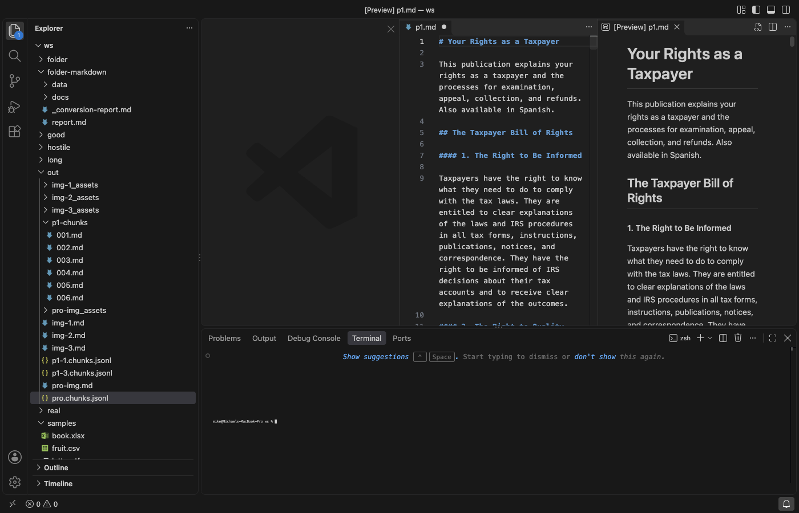
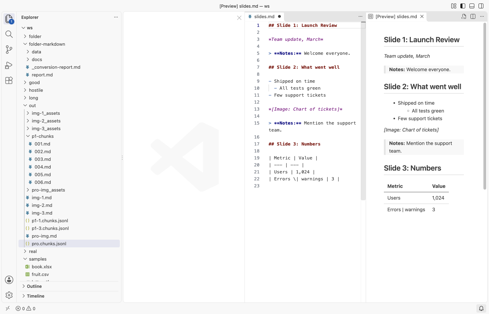
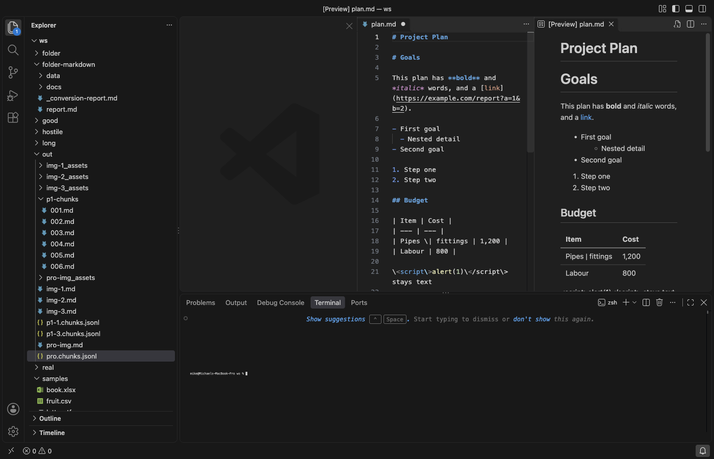

# Convert to Markdown for PDF, PPTX, DOCX, Excel and HTML files

Zovo Pro: USD 19 once, every Zovo tool. Convert a whole folder, Extract images and LLM-ready output are Pro, with 3 free tries each; converting single files stays free.

Right-click a PDF, Word, PowerPoint, Excel, CSV, HTML, EPUB, ODT or RTF file in VS Code and pick Convert to Markdown. The Markdown opens beside the file, with headings, paragraphs, bold and italic, lists, tables, links, code blocks, slide sections and speaker notes. Nothing to install: no Python, no server, no command-line tool. Nothing leaves your computer.

## Formats

| File | What you get |
|---|---|
| PDF (`.pdf`) | Headings from the font sizes, paragraphs with broken lines and hyphenated words joined, bullet and numbered lists, simple tables, two-column pages read column by column. Running headers, footers and page numbers are dropped. |
| Word (`.docx`, `.docm`, `.dotx`) | Headings, bold, italic, strikethrough, links, nested lists, tables, block quotes, footnotes. |
| PowerPoint (`.pptx`, `.pptm`, `.ppsx`, `.potx`) | `## Slide n: title` for each slide, bullets with their levels, tables, pictures and the speaker notes. |
| Excel and other sheets (`.xlsx`, `.xlsm`, `.xlsb`, `.xls`, `.ods`) | `## Sheet: name` for each sheet with a pipe table; dates and numbers as the sheet shows them. |
| CSV, TSV | One pipe table. |
| HTML (`.html`, `.htm`, `.xhtml`) | Headings, lists, tables, links, code blocks with their language. Scripts and styles are dropped. |
| EPUB (`.epub`) | Each chapter in reading order. |
| OpenDocument text (`.odt`), RTF, old Word (`.doc`) | Text, paragraphs and tables. |

Images become placeholders such as `*[Image: Map of the site]*`, with the alt text when the file has one.

## How to use it

- Explorer: right-click a file, Convert to Markdown or Copy as Markdown. Select several files to convert them one after the other.
- Editor tab: right-click the tab of an open file.
- Command Palette: Convert to Markdown: Convert to Markdown converts the file in the active tab, or asks for one.
- The result opens as an unsaved Markdown document beside the source; Save fills in `name.md` next to the source. Set Convert to Markdown: Output to `file` to save it there at once.
- Big files show progress with a Cancel button. Files over 200 MB are not converted (setting `toMarkdown.maxFileSizeMB`), and a PDF stops after 1,000 pages (setting `toMarkdown.pdfMaxPages`); a message says so.

## Free and Pro

Free, with no limit: Convert to Markdown and Copy as Markdown for every format above.

Zovo Pro adds three tools. Each has 3 free tries on your computer; a try counts only after the tool wrote its files, and Escape or Cancel never uses one.

| Pro tool | What it does |
|---|---|
| Convert a whole folder | Every supported file in a folder and its subfolders becomes a `.md` file in a mirrored folder (or next to each file), with progress, Cancel, a skip-or-overwrite choice for existing files and a `_conversion-report.md` summary. |
| Extract images | Saves the pictures of a Word, PowerPoint, PDF, ODT or EPUB file to a `name_assets` folder next to the `.md` and links them with relative paths, so the Markdown shows them. |
| LLM-ready output | YAML front matter (title, source file, pages or slides, date), the text split into chunks at headings with a token estimate for each (characters / 4), saved as one Markdown file per chunk or as one JSONL file. |

Zovo Pro is USD 19 once and turns on the Pro tools in every Zovo extension. To hide the three Pro commands, set `toMarkdown.showProTools` to `false`.

## Safe with any file

- Every converter runs in a separate worker thread with a 2 GB memory cap and a watchdog, so a damaged, huge or hostile file cannot freeze VS Code.
- ZIP bombs, PDFs with thousands of pages, broken XML and deep nesting are capped or refused with a message.
- Text that looks like HTML or script stays text in the Markdown.
- Password-protected files and old PowerPoint 97-2003 files get a clear message instead of garbage.
- No network calls and no telemetry. The libraries are bundled: pdf.js, mammoth, SheetJS, parse5 and fflate (see THIRD-PARTY-NOTICES.txt).

## Commands

| Command | |
|---|---|
| Convert to Markdown | Converts the file and opens the Markdown beside it |
| Copy as Markdown | Converts the file and copies the Markdown |
| Convert a Folder to Markdown (Pro) | All supported files in a folder |
| Convert to Markdown with Images (Pro) | Markdown plus an assets folder |
| Convert to LLM-ready Markdown Chunks (Pro) | Front matter, chunks and token estimates |
| Convert a sample file | Converts a bundled sample (Word, PDF or PowerPoint) |

## Settings

| Setting | Default | |
|---|---|---|
| `toMarkdown.output` | `untitled` | `untitled`: an unsaved document beside the source. `file`: save `name.md` next to the source. |
| `toMarkdown.maxFileSizeMB` | 200 | Larger files are not converted. |
| `toMarkdown.pdfMaxPages` | 1000 | PDF pages converted at most. |
| `toMarkdown.llmChunkTokens` | 800 | Largest LLM-ready chunk, in estimated tokens. |
| `toMarkdown.showProTools` | true | Show the three Pro commands. |
| `toMarkdown.askForRating` | true | Ask once, after a few days of use, for a rating. |

## Limits

- Scanned PDFs (pictures of pages) have no text to convert; text recognition (OCR) is not included.
- PDF tables are found from the gaps between columns. Tables without clear gaps come out as paragraphs.
- Charts, SmartArt and video in slides are named (`*[Chart]*`), not converted.
- Old Word 97-2003 files and RTF give text and tables without formatting.

## Support Zovo

Zovo Pro: USD 19 once, every Zovo viewer. [Get Zovo Pro on GitHub Sponsors](https://github.com/sponsors/theluckystrike/sponsorships?tier_id=679878) to turn on the Pro tools in this extension and in the other Zovo extensions you use. The free features stay free.

Zovo extensions have no ads and no tracking. They are made by [theluckystrike](https://github.com/theluckystrike) on GitHub. You can also support the work with no Pro:

- [Sponsor on GitHub](https://github.com/sponsors/theluckystrike)
- [PayPal](https://www.paypal.com/paypalme/najzzz)
- [Follow theluckystrike on GitHub](https://github.com/theluckystrike)

### Need your format supported?

Open a [format request](https://github.com/theluckystrike/convert-to-markdown-vscode/issues/new?template=format-request.yml) with a sample file, and I reply there whether it can be done. For USD 299 once, through [this GitHub Sponsors tier](https://github.com/sponsors/theluckystrike/sponsorships?tier_id=679995), I add your file format or a missing feature to this extension, with tests, within 7 days.

## More tools by Zovo

- [PDF Viewer & PDF Reader to Read and View PDF (Dark Mode)](https://marketplace.visualstudio.com/items?itemName=zovo.pdf-viewer-dark) reads PDFs with a real dark mode, search, an outline and thumbnails.
- [DOCX Viewer & ODT Viewer, Word Document Preview (Dark Mode)](https://marketplace.visualstudio.com/items?itemName=zovo.docx-viewer-vscode) previews Word and ODT files with dark mode, an outline and search.
- [PPTX Viewer & PowerPoint Preview, PPT Presentation Slideshow](https://marketplace.visualstudio.com/items?itemName=zovo.pptx-slide-viewer) shows PowerPoint slides, thumbnails and speaker notes.
- [XLSX Viewer, Excel Viewer, CSV Viewer & Parquet Viewer (XLS, CSV Preview)](https://marketplace.visualstudio.com/items?itemName=zovo.table-viewer-vscode) opens CSV, TSV, Excel and Parquet files as a sortable, filterable table.
- [EML Viewer, Email Headers & MBOX Viewer](https://marketplace.visualstudio.com/items?itemName=zovo.eml-viewer) reads EML, EMLX and MBOX email files with remote images blocked.

See [all Zovo extensions on the Marketplace](https://marketplace.visualstudio.com/publishers/zovo).
